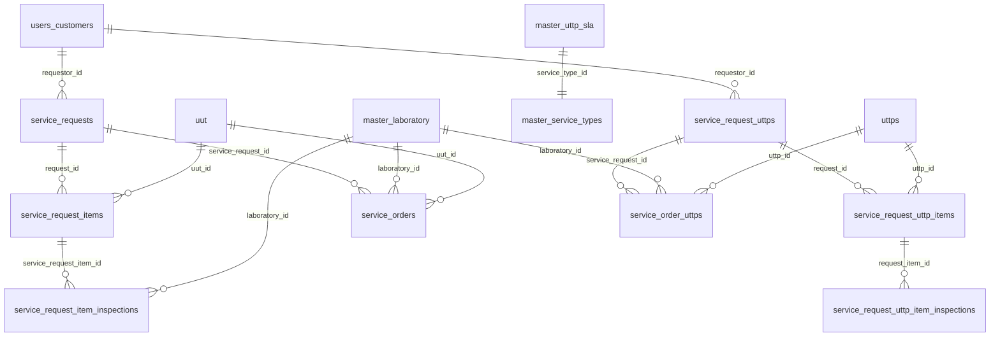
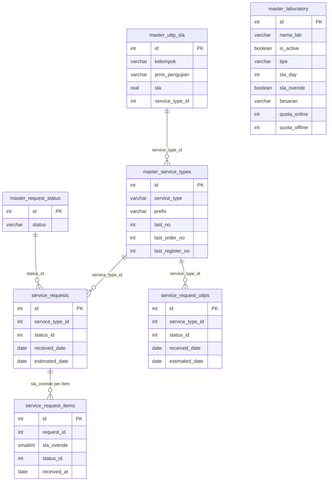
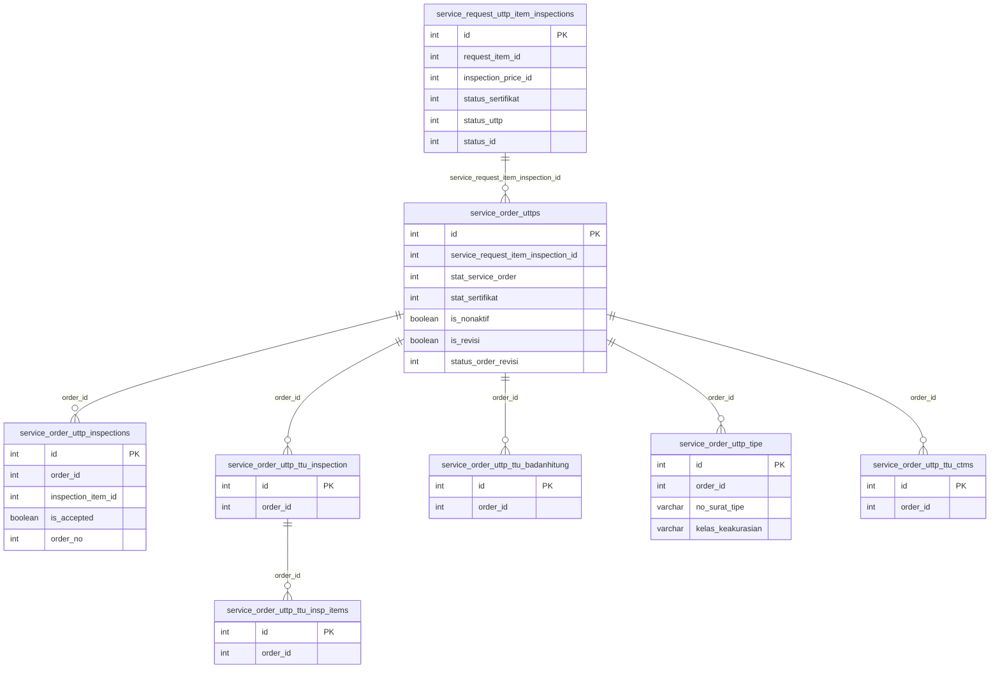
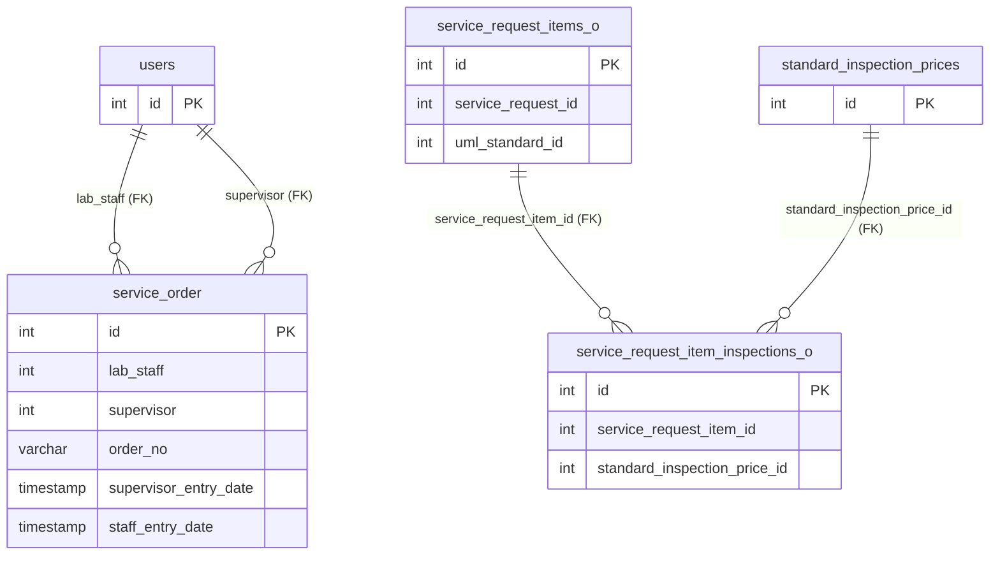

# Service Order Domain — Entity Relationship Diagram

> **Project:** ServiceIQ — AI-Powered Enterprise Service Intelligence Platform
> **Source:** `dump-siks_n_prd-202610031054.sql` — DDL only, no data.
> **Notation:** Mermaid `erDiagram`. Only authoritative, active tables are shown. Legacy/backup tables are excluded.
> Solid relationship lines = column-level reference (no FK constraint unless noted).
> `FK` annotation = declared `FOREIGN KEY` constraint exists in DDL.
> **Last verified:** column definitions confirmed against DDL extracted from the binary dump.

---

## Part 1 — High-Level Domain Overview

---

## Part 2 — UUT Track (Calibration Instruments)

```mermaid
erDiagram
    users_customers {
        int id PK
        varchar full_name
        varchar email
        int uml_id
        int uut_owner_id
        int uttp_owner_id
        int bentuk_usaha_id
        boolean is_active
    }

    service_requests {
        int id PK
        int requestor_id
        int uut_owner_id
        int service_type_id
        int status_id
        int stat_service_request
        int payment_status_id
        int status_sertifikat
        int pending_status
        int cancel_id
        date received_date
        date estimated_date
        date payment_expired_date
        int booking_id
        varchar no_register
        varchar no_order
        varchar billing_code
        int uml_id
        int service_request_id
        int service_order_id
    }

    service_request_items {
        int id PK
        int request_id
        int service_request_id
        int uut_id
        int uml_standard_id
        int standard_id
        int quantity
        real subtotal
        int status_id
        varchar stat_service_request_item
        smallint sla_overide
        varchar no_order
        date delivered_at
        date received_at
        date order_at
    }

    service_request_item_inspections {
        int id PK
        int service_request_item_id
        int inspection_price_id
        int laboratory_id
        int price
        int qty_inspection
        int quantity
        int status_id
        int status_sertifikat
        int service_status_id
        int request_item_id
        date created_at
        date updated_at
    }

    service_orders {
        int id PK
        int service_request_id
        int service_request_item_id
        int service_request_item_inspection_id
        int request_item_id
        int laboratory_id
        int uut_id
        int lab_staff
        int supervisor_staff
        int ditmet_staff
        int kadivtek_staff
        int kalab_id
        int kabalai_id
        int subkoordinator_id
        int stat_service_order
        int is_finish
        int stat_sertifikat
        int stat_warehouse
        int pending_status
        boolean is_certified
        boolean hasil_uji_memenuhi
        boolean is_pnbp_returned
        boolean is_skhpt
        int batal_type
        varchar no_sertifikat
        date sertifikat_expired_at
        timestamp cancel_at
        int cancel_id
        date staff_entry_datein
        date staff_entry_dateout
        real return_value
        timestamp return_date
    }

    service_order_inspections {
        int id PK
        int order_id
        int inspection_item_id
        boolean is_accepted
    }

    service_order_uut_insitu_laporan {
        int id PK
        int service_order_id
        int service_request_id
        int service_request_item_id
        text ringkasan
        text kendala_teknis
        text kendala_non_teknis
        text metode_tindakan
        text saran_masukan
    }

    master_laboratory {
        int id PK
        varchar nama_lab
        boolean is_active
        varchar tipe
        int sla_day
        boolean sla_overide
        varchar besaran
        int quota_online
        int quota_offline
    }

    uut {
        int id PK
        int owner_id
        int type_id
        varchar serial_no
        varchar tool_brand
        varchar tool_model
        varchar tool_capacity
    }

    users_customers ||--o{ service_requests : "requestor_id"
    service_requests ||--o{ service_request_items : "request_id"
    service_request_items ||--o{ service_request_item_inspections : "service_request_item_id"
    service_request_item_inspections ||--o{ service_orders : "service_request_item_inspection_id"
    service_requests ||--o{ service_orders : "service_request_id"
    service_request_items ||--o{ service_orders : "service_request_item_id"
    master_laboratory ||--o{ service_orders : "laboratory_id"
    master_laboratory ||--o{ service_request_item_inspections : "laboratory_id"
    service_orders ||--o{ service_order_inspections : "order_id"
    service_orders ||--o{ service_order_uut_insitu_laporan : "service_order_id"
    uut ||--o{ service_request_items : "uut_id"
    uut ||--o{ service_orders : "uut_id"
```

---

## Part 3 — UTTP Track (Weighing & Measuring Instruments)

```mermaid
erDiagram
    users_customers {
        int id PK
        varchar full_name
        varchar email
        int uttp_owner_id
        int bentuk_usaha_id
        boolean is_active
    }

    service_request_uttps {
        int id PK
        int requestor_id
        int pic_id
        int booking_id
        int uttp_owner_id
        int service_type_id
        int stat_service_request
        int status_id
        int payment_status_id
        int spuh_payment_status_id
        int status_sertifikat
        int pending_status
        int cancel_id
        timestamp cancel_at
        date received_date
        date estimated_date
        timestamp payment_expired_date
        varchar no_register
        varchar no_order
        varchar billing_code
        varchar requestor_name
        varchar requestor_phone_no
    }

    service_request_uttp_items {
        int id PK
        int request_id
        int uttp_id
        int uml_standard_id
        int quantity
        int subtotal
        int status_id
        boolean is_pemeriksaan
        timestamp delivered_at
        timestamp received_at
        timestamp order_at
    }

    service_request_uttp_item_inspections {
        int id PK
        int request_item_id
        int inspection_price_id
        real price
        int quantity
        int status_id
        int status_sertifikat
        int status_uttp
    }

    service_order_uttps {
        int id PK
        int service_request_id
        int service_request_item_id
        int service_request_item_inspection_id
        int laboratory_id
        int uttp_id
        int lab_staff
        int supervisor_staff
        int stat_service_order
        int is_finish
        int stat_sertifikat
        int stat_warehouse
        int pending_status
        timestamp cancel_at
        int cancel_id
        varchar no_sertifikat
        varchar no_sertifikat_tipe
        date sertifikat_expired_at
        boolean hasil_uji_memenuhi
        boolean hasil_pemeriksaan_memenuhi
        boolean is_revisi
        boolean is_nonaktif
        boolean is_skhpt
        int revisi_ke
        int revision_id
        int order_direvisi_id
        int status_order_revisi
        date mulai_uji
        date selesai_uji
        date staff_entry_datein
        date staff_entry_dateout
        double location_lat
        double location_long
    }

    service_order_uttp_inspections {
        int id PK
        int order_id
        int inspection_item_id
        boolean is_accepted
        int order_no
    }

    service_order_uttp_insitu_laporan {
        int id PK
        int service_order_id
        int service_request_id
        int service_request_item_id
        text ringkasan
        text kendala_teknis
        text kendala_non_teknis
        text metode_tindakan
        text saran_masukan
    }

    master_laboratory {
        int id PK
        varchar nama_lab
        boolean is_active
        int sla_day
        boolean sla_overide
        varchar besaran
    }

    uttps {
        int id PK
        int owner_id
        int type_id
        varchar serial_no
        varchar tool_brand
        varchar tool_model
        varchar tool_capacity
    }

    users_customers ||--o{ service_request_uttps : "requestor_id"
    service_request_uttps ||--o{ service_request_uttp_items : "request_id"
    service_request_uttp_items ||--o{ service_request_uttp_item_inspections : "request_item_id"
    service_request_uttp_item_inspections ||--o{ service_order_uttps : "service_request_item_inspection_id"
    service_request_uttps ||--o{ service_order_uttps : "service_request_id"
    service_request_uttp_items ||--o{ service_order_uttps : "service_request_item_id"
    master_laboratory ||--o{ service_order_uttps : "laboratory_id"
    service_order_uttps ||--o{ service_order_uttp_inspections : "order_id"
    service_order_uttps ||--o{ service_order_uttp_insitu_laporan : "service_order_id"
    uttps ||--o{ service_request_uttp_items : "uttp_id"
    uttps ||--o{ service_order_uttps : "uttp_id"
```

---

## Part 4 — SLA & Reference Data

> **SLA computation note:** `sla_deadline = received_date + master_laboratory.sla_day`. There is no stored `sla_deadline` column on any table. `master_uttp_sla` cannot be directly joined to order tables — it keys on `kelompok` + `jenis_pengujian` + `service_type_id`.

---

## Part 5 — Inspection Hierarchy Detail

---

## Part 6 — Declared FK Constraints Only

The following diagram shows **only** relationships with declared `FOREIGN KEY` constraints in DDL.

> **Critical:** `service_order` (6-column prototype table) is the **only** service-domain table with declared FK constraints. All four declared FKs are on **legacy tables only**. The production tables (`service_orders`, `service_order_uttps`, `service_requests`, `service_request_uttps`, etc.) have **zero declared FK constraints** and rely entirely on application-level referential integrity.

---

## Part 7 — Full Domain Connectivity Map

```mermaid
erDiagram
    users_customers ||--o{ service_requests : "requestor_id"
    users_customers ||--o{ service_request_uttps : "requestor_id"

    service_requests ||--o{ service_request_items : "request_id"
    service_request_items ||--o{ service_request_item_inspections : "service_request_item_id"
    service_request_item_inspections ||--o{ service_orders : "service_request_item_inspection_id"
    service_requests ||--o{ service_orders : "service_request_id"
    service_orders ||--o{ service_order_inspections : "order_id"
    service_orders ||--o{ service_order_uut_insitu_laporan : "service_order_id"
    service_orders ||--o{ service_order_uut_tipe : "order_id"
    service_orders ||--o{ service_order_uut_ttu_inspection : "order_id"
    service_orders ||--o{ service_order_uut_ttu_badanhitung : "order_id"
    service_orders ||--o{ service_order_uut_ttu_insp_items : "order_id"
    service_orders ||--o{ service_order_uut_ttu_perlengkapan : "order_id"

    service_request_uttps ||--o{ service_request_uttp_items : "request_id"
    service_request_uttp_items ||--o{ service_request_uttp_item_inspections : "request_item_id"
    service_request_uttp_item_inspections ||--o{ service_order_uttps : "service_request_item_inspection_id"
    service_request_uttps ||--o{ service_order_uttps : "service_request_id"
    service_order_uttps ||--o{ service_order_uttp_inspections : "order_id"
    service_order_uttps ||--o{ service_order_uttp_insitu_laporan : "service_order_id"
    service_order_uttps ||--o{ service_order_uttp_tipe : "order_id"
    service_order_uttps ||--o{ service_order_uttp_ttu_inspection : "order_id"
    service_order_uttps ||--o{ service_order_uttp_ttu_badanhitung : "order_id"
    service_order_uttps ||--o{ service_order_uttp_ttu_insp_items : "order_id"
    service_order_uttps ||--o{ service_order_uttp_ttu_perlengkapan : "order_id"
    service_order_uttps ||--o{ service_order_uttp_ttu_ctms : "order_id"

    uut ||--o{ service_request_items : "uut_id"
    uut ||--o{ service_orders : "uut_id"
    uttps ||--o{ service_request_uttp_items : "uttp_id"
    uttps ||--o{ service_order_uttps : "uttp_id"

    master_laboratory ||--o{ service_orders : "laboratory_id"
    master_laboratory ||--o{ service_order_uttps : "laboratory_id"
    master_laboratory ||--o{ service_request_item_inspections : "laboratory_id"

    master_service_types ||--o{ service_requests : "service_type_id"
    master_service_types ||--o{ service_request_uttps : "service_type_id"
    master_uttp_sla ||--o{ master_service_types : "service_type_id"
    master_request_status ||--o{ service_requests : "status_id"
```

---

## Summary: Relationship Notation Key

| Notation | Meaning |
|----------|---------|
| `\|\|--o{` | One (mandatory) to zero-or-many |
| `\|\|--\|\|` | One to exactly one |
| `FK` annotation | Enforced by `FOREIGN KEY` constraint in DDL |
| No annotation | Convention-based reference only; no FK constraint |

---

## Key Facts for AI Layer

| Fact | Value |
|------|-------|
| Declared FK constraints in service domain | **4 total — all on legacy tables** |
| Production tables with FK constraints | **0** |
| Parallel service tracks | **2** (UUT + UTTP) |
| Legacy/backup tables to exclude | **16+** |
| SLA column location | `master_laboratory.sla_day` (primary); `master_uttp_sla.sla` (reference, no direct join) |
| Customer entry point | `users_customers` via `requestor_id` (no FK) |
| Index on service_orders → service_requests | **Yes** (`service_orders_service_request_id_idx`) |
| `cancel_at` on service_requests (UUT) | **Does NOT exist** — `cancel_id` only |
| `cancel_at` on service_request_uttps (UTTP) | **Exists** |
| `service_orders_old` sequence | **Shares `service_labs_id_seq` with `service_orders`** — IDs may collide |
| UTTP revision tracking columns | `is_revisi`, `is_nonaktif`, `revisi_ke`, `revision_id`, `order_direvisi_id`, `status_order_revisi` — UUT does not have these |
| Preferred AI entry point | `public.ai_service_order_summary` view |
